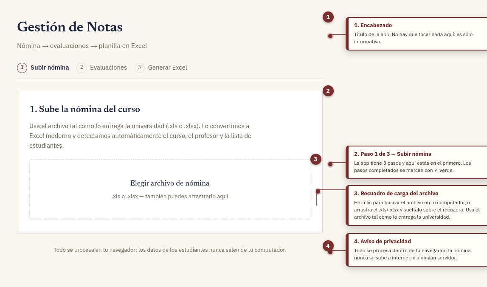
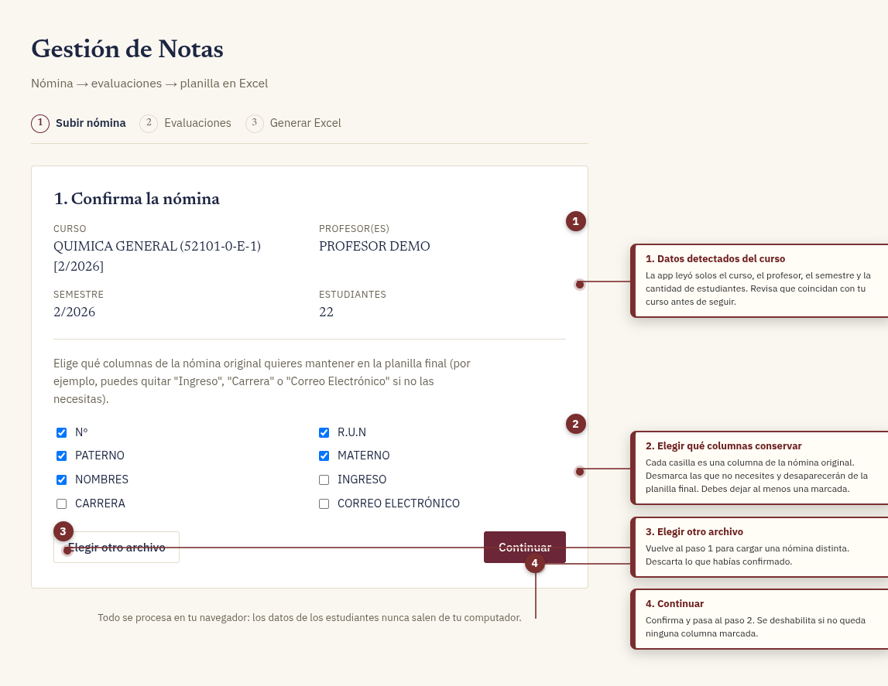
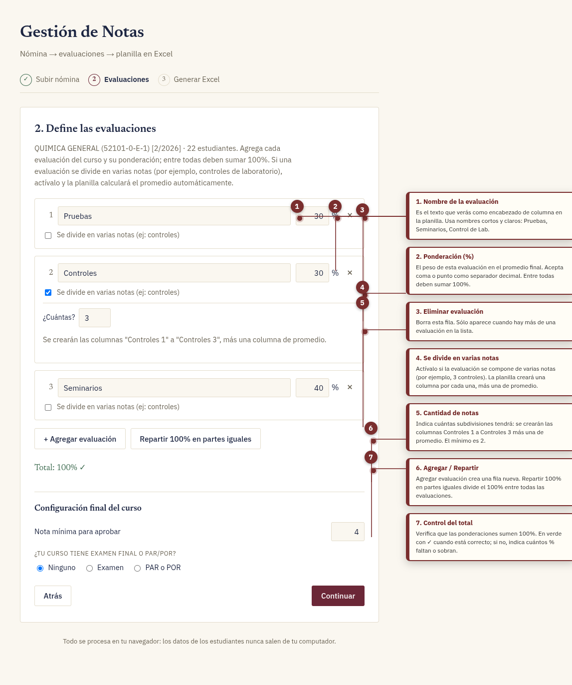
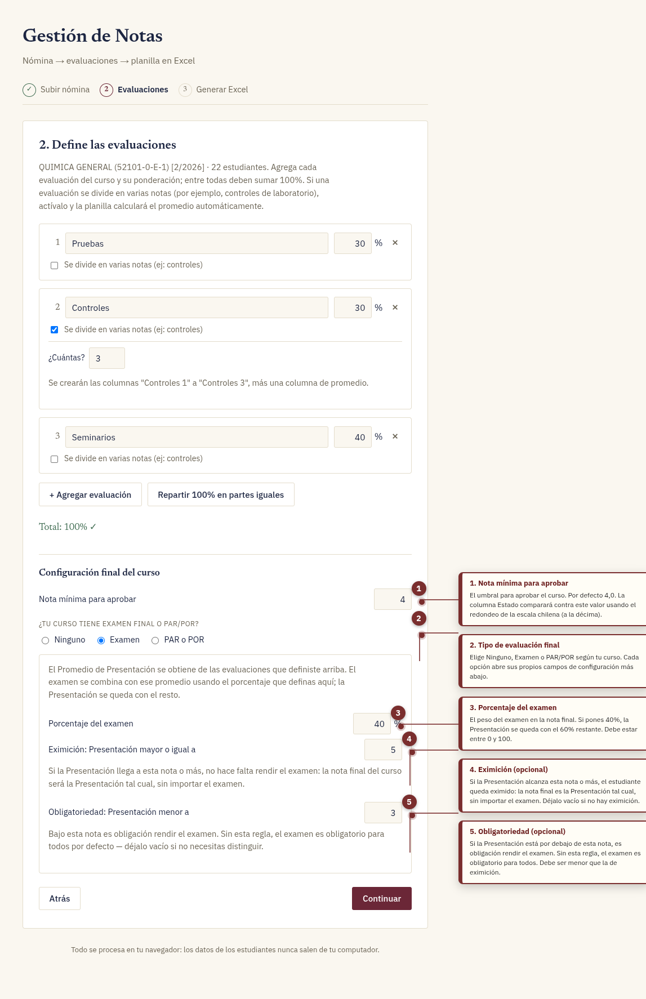
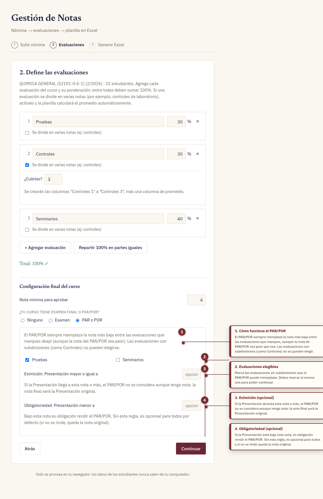
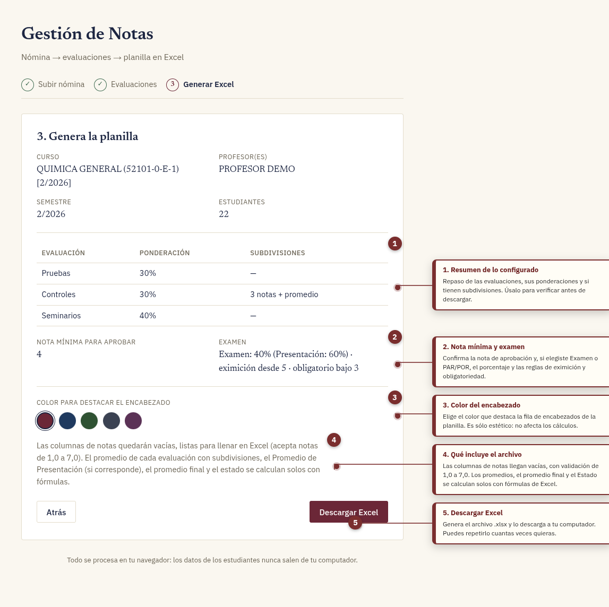
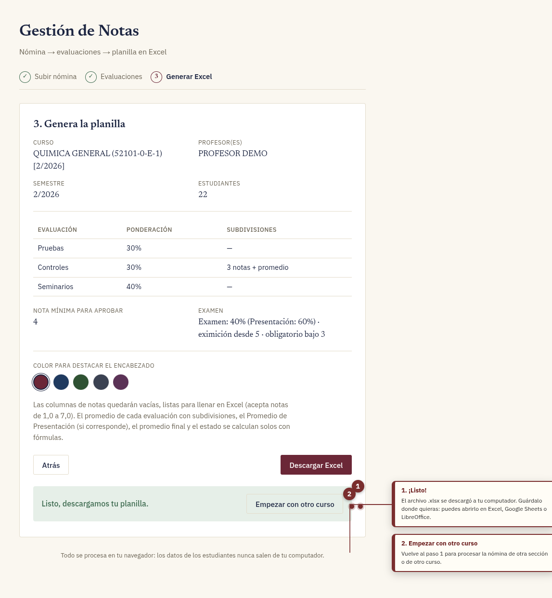
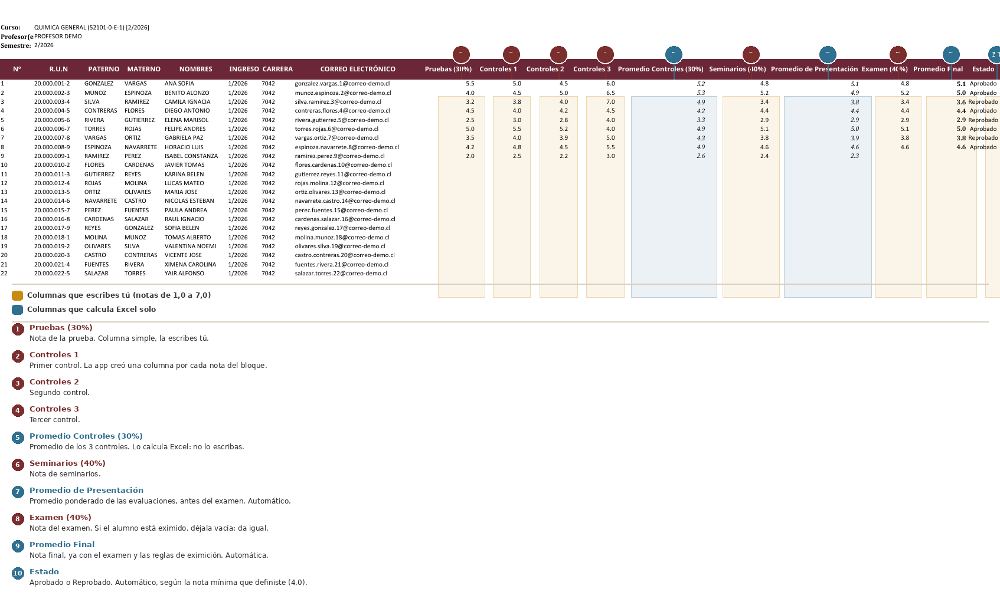

# Tutorial: Cómo usar la app «Gestión de Notas»

Guía completa, paso a paso, con capturas anotadas de la aplicación y del
archivo de Excel que genera.

> **Importante sobre la privacidad.** Este tutorial usa una **nómina de
> demostración con datos inventados** (nombres, R.U.N. y correos ficticios,
> todos con dominio `@correo-demo.cl`). No se muestra ningún dato real de
> estudiantes. La app, además, procesa todo dentro del navegador: el archivo
> nunca sale de tu computador.

---

## Antes de empezar

### Qué hace la aplicación

La app transforma la **nómina de estudiantes que entrega la universidad**
(archivo `.xls` o `.xlsx`) en una **planilla de notas moderna y bienodotada**:
todas las columnas de evaluación ya creadas, listas para que ingreses las
notas y para que Excel calcule los promedios solo.

### Qué necesitas

- Un navegador web reciente (Chrome, Firefox, Edge o Safari).
- La nómina del curso en su formato original (`.xls` o `.xlsx`).
- Microsoft Excel, Google Sheets o LibreOffice para trabajar el archivo final.

### Cómo abrir la aplicación

La aplicación está publicada en línea. **Sólo tienes que abrir este link en el
navegador:**

### → [plantilla-usach.vercel.app](https://plantilla-usach.vercel.app/)

No necesitas instalar nada. Funciona en cualquier navegador moderno, desde el
computador o desde el celular.

Todo lo que harás es arrastrar el archivo y descargar el Excel.

---

## El recorrido, en 3 pasos

| Paso | Qué haces | Resultado |
|---|---|---|
| 1 | Subes la nómina | La app lee el curso y la lista de estudiantes |
| 2 | Defines las evaluaciones | Quedan fijadas las columnas y su ponderación |
| 3 | Generas el Excel | Descargas la planilla lista para llenar notas |

---

# Paso 1 · Subir la nómina



### 1. Encabezado

Sólo informativo: el título de la app y el subtítulo con el flujo general
(*Nómina → evaluaciones → planilla en Excel*). No hay nada que configurar acá.

### 2. Indicador de pasos

La barra superior muestra las tres etapas. El paso en el que estás aparece
resaltado y los pasos ya completados se marcan con un ✓ verde. Es sólo una
referencia visual: **puedes volver atrás en cualquier momento** con el botón
*Atrás* sin perder lo que ya configuraste.

### 3. Recuadro de carga del archivo

Aquí es donde entregas la nómina. Tienes dos formas de hacerlo:

- **Clic** en el recuadro → se abre el explorador de archivos y eliges la
  nómina.
- **Arrastrar y soltar**: toma el archivo desde tu carpeta y suéltalo
  encima del recuadro. Mientras lo arrastras, el recuadro se resalta para
  mostrarte que lo reconoce.

La app acepta el archivo **tal como lo entrega la universidad**: no necesitas
convertirlo, renombrarlo ni abrirlo antes. Al leerlo detecta automáticamente:

- El **nombre y código del curso**
- El **profesor o profesoras**
- El **semestre**
- La **lista de estudiantes**, reconociendo la columna `R.U.N`

> **Si aparece un error**, normalmente significa que el archivo no tiene la
> columna `R.U.N` (o `RUT`), que es la que le dice a la app dónde empieza la
> tabla de estudiantes. Revisa que sea una nómina del mismo formato que usa tu
> universidad.

### 4. Aviso de privacidad

Todo el procesamiento ocurre **dentro de tu navegador**. El archivo no se sube
a internet, no se guarda en un servidor y no se envía a ninguna parte. El
archivo final se genera también en tu navegador y se descarga directo a tu
computador.

---

## 1.b · Confirmar la nómina

Apenas subes el archivo, la app te muestra qué entendió para que lo verifiques
antes de seguir.



### 1. Datos detectados del curso

Curso, profesor(es), semestre y cantidad de estudiantes, leídos
automáticamente del archivo. **Revisa que coincidan con tu curso**: si algo
está mal, es más fácil detectarlo ahora que descubrirlo en la planilla final.

### 2. Elegir qué columnas conservar

Cada casilla es una columna de la nómina original, tal como viene. Puedes
desmarcar las que no necesites en tu planilla de notas.

En el ejemplo de la captura se desmarcaron **Ingreso**, **Carrera** y **Correo
Electrónico**: son datos que están en la nómina pero que normalmente no hacen
falta para registrar notas.

Recomendación práctica: quédate con lo que uses routinely para identificar al
alumno (*Nº*, *R.U.N*, *PATERNO*, *MATERNO*, *NOMBRES*) y quita lo demás. La
planilla queda más manejable y evita exponer datos que no necesitas.

**Debes dejar al menos una columna marcada**; si las desmarcas todas, la app
te avisa y no deja continuar.

### 3. Elegir otro archivo

Vuelve al paso 1 para cargar una nómina distinta (otra sección, otro curso).
Descarta lo que habías confirmado.

### 4. Continuar

Confirma los datos y pasa al paso 2. El botón queda deshabilitado si queda
alguna regla sin cumplir (por ejemplo, si no queda ninguna columna marcada).

---

# Paso 2 · Definir las evaluaciones

Acá decides cómo se estructura el curso: qué evaluaciones hay, cuánto pesa cada
una y cómo se calcula la nota final.



### 1. Nombre de la evaluación

El texto que **aparecerá como encabezado de columna** en la planilla final.
Usa nombres cortos y claros: *Pruebas*, *Seminarios*, *Control de Lab*,
*Trabajo en grupo*… Evita nombres tan largos que la columna se vea angosta.

### 2. Ponderación (%)

El peso de esa evaluación en el promedio final. Acepta coma o punto como
separador decimal (`33,33` y `33.33` funcionan igual).

**Las ponderaciones de todas las evaluaciones deben sumar 100%.** Si tienes
muchas evaluaciones y no sabes cómo repartirlas, el botón *Repartir 100% en
partes iguales* (punto 6) lo hace por ti.

### 3. Eliminar evaluación

Borra esa fila. Sólo aparece cuando tienes más de una evaluación en la lista;
siempre vas a quedar con al menos una.

### 4. «Se divide en varias notas»

Activa esta casilla cuando una evaluación se compone de **varias notas
separadas** y sólo su promedio cuenta. Ejemplos típicos:

- 3 controles de laboratorio → promediar los 3
- 2 seminarios → promediar ambos
- informes semanales → promediar los n informes

La app **no** te pide el nombre de cada nota: las numera automáticamente
(*Control 1*, *Control 2*, …) y agrega una columna de promedio.

### 5. Cantidad de notas

Indica **cuántas** subdivisiones tendrá esa evaluación. En la captura se puso
`3`, así que la planilla creará las columnas *Controles 1*, *Controles 2* y
*Controles 3*, más una columna `Promedio Controles (30%)`.

El mínimo es 2 (si es una sola nota, no marques la casilla: usa el paso 2 de
esta misma lista).

### 6. Agregar evaluación / Repartir 100% en partes iguales

- **+ Agregar evaluación** crea una fila nueva para otra evaluación del curso.
- **Repartir 100% en partes iguales** divide el 100% en el mismo número para
  todas. Si tienes 3 evaluaciones, las tres quedan con 33,33% cada una.

> **Detalle útil:** cuando todas las evaluaciones tienen exactamente el mismo
> peso, la planilla usa un simple `AVERAGE()` en vez de una suma ponderada. Se
> ve más limpio en las fórmulas y es matemáticamente idéntico.

### 7. Control del total

Verifica que todo cuadre. En verde con ✓ significa que la suma es 100%. Si no,
te dice cuántos porcentajes **faltan** o **sobran**, para que ajustes.

El botón *Continuar* permanece deshabilitado hasta que el total llegue a 100%,
todas las evaluaciones tengan nombre y la configuración final sea válida.

---

## Configuración final del curso

Esta sección aparece al final del paso 2 y controla dos cosas: **la nota
mínima para aprobar** y **el tipo de evaluación final**.

### Nota mínima para aprobar

El umbral con el que se decidirá si el alumno aprueba. Por defecto es **4,0**,
que es lo habitual en Chile. Si tu curso usa otro valor (por ejemplo 3,5 o 5,0),
cámbialo acá.

> **Sobre el redondeo.** La escala chilena redondea a la décima. Eso significa
> que un promedio real de **3,95 ya redondea a 4,0 y aprueba**, aunque el
> número "crudo" esté por debajo del 4,0. La app tiene en cuenta esto y
> compara contra `nota mínima − 0,05` sobre el promedio sin redondear, que es
> como lo hace el manual. Por eso **no عليك el Promedio Final antes de mirar el
> Estado**: las dos columnas pueden no coincidir en los casos límite, y es lo
> correcto.

---

## Opción A · El curso tiene Examen



### 1. Nota mínima para aprobar

Lo mismo que en la sección anterior: el umbral de aprobación del curso.

### 2. Tipo de evaluación final

Elige entre **Ninguno**, **Examen** y **PAR o POR**. Al marcar *Examen* se
abren los campos de abajo.

### 3. Porcentaje del examen

El peso del examen en la nota final. Si pones **40%**, el examen vale el 40% y
la Presentación se queda automáticamente con el 60% restante. No necesitas
definir las dos.

### 4. Eximición (opcional)

`Eximisión: Presentación mayor o igual a ___`

Si la Presentación del alumno alcanza esta nota o más, **queda eximido de
rendir el examen**: su nota final es la Presentación tal cual, sin importar
qué haya sacado en el examen.

En la captura se puso **5**, o sea: con Presentación 5,0 o más, el alumno
aprueba con Presentación y no le afecta el examen.

Déjalo vacío si tu curso no tiene eximición.

### 5. Obligatoriedad (opcional)

`Obligatoriedad: Presentación menor a ___`

Si la Presentación está **por debajo** de esta nota, es **obligación** rendir el
examen. En la captura se puso **3**: un alumno con Presentación menor que 3,0
tiene que rendir el examen sí o sí.

Sin esta regla, el examen es **obligatorio para todos**.

> **Regla de validación:** la nota de obligatoriedad debe ser **menor** que la
> de eximición (si no, quedarían rangos contradictorios). La app lo avisa y no
> deja continuar.

---

## Opción B · El curso tiene PAR/POR



### 1. Cómo funciona el PAR/POR

El PAR/POR **siempre reemplaza la nota más baja** entre las evaluaciones que
tengas marcadas — incluso si tu nota de PAR/POR es **peor** que esa nota. Es el
criterio estándar: no se elige "la que más te conviene", sino que sustituye a la
más baja.

> Las evaluaciones **con subdivisiones** (como *Controles*) **no pueden
> elegirse**: el PAR/POR reemplaza una nota, no un promedio de varias.

### 2. Evaluaciones elegibles

Marca las evaluaciones **sin subdivisiones** que el PAR/POR puede reemplazar.
Debes marcar al menos una para poder continuar. En la captura se marcó
*Pruebas* y se dejó *Seminarios* sin marcar: el PAR/POR reemplazará la nota de
Pruebas, no la de Seminarios.

### 3. Eximición (opcional)

`Eximición: Presentación mayor o igual a ___`

Si la Presentación alcanza esta nota o más, el PAR/POR **no se considera
aunque tenga nota**: la nota final es la Presentación original.

### 4. Obligatoriedad (opcional)

`Obligatoriedad: Presentación menor a ___`

Si la Presentación está bajo esta nota, es **obligación** rendir el PAR/POR.

Sin esta regla, el PAR/POR es **opcional para todos**: si el alumno no lo
rinde, queda la nota original sin reemplazo.

> Las reglas de eximición y obligatoriedad del PAR/POR se calculan **sobre la
> Presentación original**, es decir, antes de aplicar el reemplazo. Es lo que
> permite que un alumno con buena Presentación se exima aunque el PAR/POR le
> saliera mal.

---

# Paso 3 · Generar y descargar la planilla

Antes de descargar, la app te muestra un resumen de todo lo que configuraste.



### 1. Resumen de lo configurado

Una tabla con cada evaluación, su ponderación y si tiene subdivisiones. Úsalo
como comprobación final: si algo no es lo que esperabas, haz clic en *Atrás*
y corrígelo antes de descargar.

### 2. Nota mínima y examen

Confirma la nota de aprobación y, si elegiste Examen o PAR/POR, el porcentaje
y las reglas de eximición y obligatoriedad, en un resumen legible
(p. ej. *Examen: 40% (Presentación: 60%) · eximición desde 5 · obligatorio
bajo 3*).

### 3. Color del encabezado

Elige el color que destaca la fila de encabezados de la planilla. Hay 5
opciones. Es **puramente estético**: no afecta ningún cálculo, así que
elige el que más te guste.

### 4. Qué incluye el archivo

Las columnas de notas llegan **vacías, listas para llenar en Excel**, y
aceptan notas de 1,0 a 7,0 (la escala chilena). El promedio de cada evaluación
con subdivisiones, el Promedio de Presentación (si corresponde), el Promedio
Final y el Estado se calculan **solos con fórmulas**.

### 5. Descargar Excel

Genera el archivo `.xlsx` y lo descarga a tu computador. El nombre del archivo
se arma solo con el nombre del curso
(p. ej. `Notas_QUIMICA_GENERAL_(52101-0-E-1)_[2-2026].xlsx`).

Si cambiaste de opinión, puedes volver atrás o simplemente volver a descargar:
el botón se puede usar las veces que quieras.

---

## La descarga



### 1. ¡Listo!

Aparece el aviso verde de que el archivo se descargó. Guárdalo donde quieras:
funciona en **Excel, Google Sheets y LibreOffice**.

### 2. Empezar con otro curso

Vuelve al paso 1 para procesar la nómina de otra sección o de otro curso. Útil
si tienes varias secciones del mismo ramo.

---

# El archivo de Excel resultante

Este es el aspecto de la planilla una vez que le ingressas las notas
(**en la versión HTML puedes desplazarla horizontalmente** para verla
completa):



### Columnas que escribes tú 🟠

Sólo las **notas**. Cada celda tiene validación: si escribes algo fuera del
rango **1,0 a 7,0**, Excel te avisa y no lo acepta. Es la escala chilena.

- **1** `Pruebas (30%)` — la nota de la prueba
- **2** `Controles 1`, **3** `Controles 2`, **4** `Controles 3` — una columna por
  cada control, porque activaste «se divide en varias notas» con 3
- **6** `Seminarios (40%)` — la nota de seminarios
- **8** `Examen (40%)` — la nota del examen. Si el alumno está eximido,
  **déjala vacía**: da igual, la fórmula lo ignora

### Columnas que calcula Excel solo 🔵

**No las escribas ni las borres.** Contienen fórmulas vivas que se recalculan
solas a medida que agregas notas:

- **5** `Promedio Controles (30%)` — promedio de los 3 controles
- **7** `Promedio de Presentación` — promedio ponderado de todas las
  evaluaciones, **antes** de aplicar el examen
- **9** `Promedio Final` — la nota final del curso, ya con el examen y las
  reglas de eximición y obligatoriedad
- **10** `Estado` — `Aprobado` o `Reprobado`, con fondo verde o rojo
  automático

### Cómo se calcula el Promedio Final

Con la configuración del ejemplo (Pruebas 30% · Controles 30% · Seminarios 40%
· Examen 40%, eximición desde 5, obligatorio bajo 3):

```
Promedio de Presentación = Pruebas×0,30 + Prom.Controles×0,30 + Seminarios×0,40

Si Presentación ≥ 5        →  Promedio Final = Presentación   (eximido)
Si Presentación < 3        →  se espera el examen:
                              sin nota de examen → queda en blanco
                              con nota           → Presentación×0,60 + Examen×0,40
En cualquier otro caso     →  sin examen: Promedio Final = Presentación
                              con examen: Presentación×0,60 + Examen×0,40
```

Fíjate en la fila 9 de la planilla de ejemplo: el alumno tiene Presentación
2,3 (obligatoria rinde examen), **no tiene nota de examen**, y por eso su
*Promedio Final* y su *Estado* quedan **en blanco**. La planilla no te muestra
un número inventado: te está avisando que falta información.

### Detalles de la planilla que te van a servir

- **Panel congelado**: las primeras 3 columnas y las 5 primeras filas quedan
  fijas. Al desplazarte hacia la derecha en una lista larga de estudiantes,
  siempre ves el R.U.N. y los nombres, y el encabezado con los nombres de las
  columnas.
- **Filas 1 a 3**: el curso, el profesor y el semestre que se leyeron de la
  nómina.
- **Columnas ajustadas automáticamente** al contenido, para que nada quede
  cortado.
- **Las fórmulas se recalculan solas**: si más tarde cambias una nota, se
  actualizan el promedio, el estado y los colores.

---

# Preguntas frecuentes

**¿Puedo cambiar algo después de descargar?**
Sí. Puedes modificar las notas en Excel con normalidad. Si necesitas cambiar la
*estructura* (agregar una evaluación, cambiar ponderaciones, agregar un
examen), vuelve a generar el archivo desde cero: la app no guarda la
configuración, así que tendrás que redefinirla.

**¿La app guarda mi configuración?**
No. Cada vez que recargas la página empiezas de cero. Las notas que ingreses sí
quedan en tu archivo de Excel, que es tu copia personal.

**¿Y mis datos personales?**
Todo se procesa en el navegador. El archivo de la nómina nunca se sube a
internet. El `.xlsx` que descargas se genera también en tu navegador.

**¿Sirve para notas de escala distinta?**
La app valida el rango **1,0 a 7,0**, que es la escala chilena.

**Me dice que no encuentra la columna R.U.N.**
La app busca una columna llamada `R.U.N` (o `RUT`) para saber dónde empieza la
tabla de estudiantes. Si tu universidad exporta las nóminas con otro formato,
hay que ajustar el archivo `src/lib/parseRoster.ts`.

**¿Cómo saco una columna de la planilla final?**
Desmárcala en el paso 1 (confirmar nómina), antes de continuar.

**¿Puedo usar la planilla en Google Sheets?**
Sí. Las fórmulas estándar y la validación de rango son compatibles. Al
subirla, Google Sheets recalcula todo automáticamente.